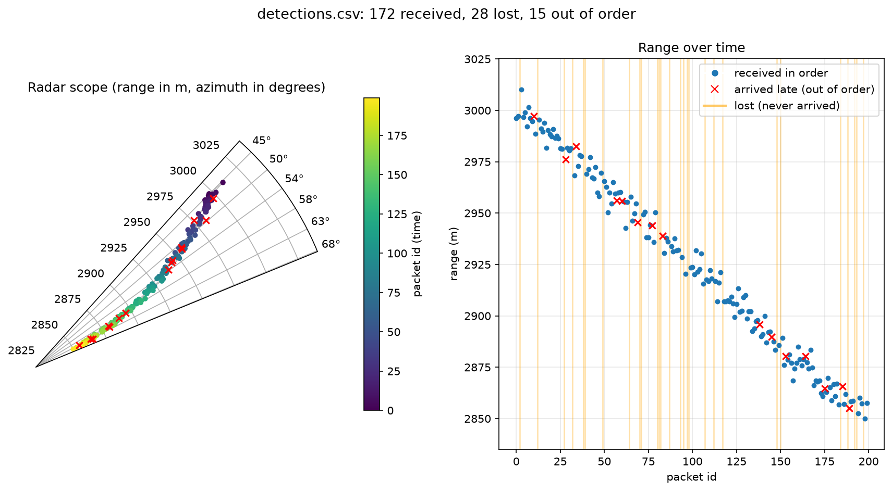

# sensor-sim

[](https://github.com/Winter0996/sensor-sim/actions/workflows/ci.yml)


A C++17 simulator for the messaging side of a radar-style sensor system. A sender streams synthetic target detections over UDP, and a receiver parses them, validates them, and detects dropped, reordered, and duplicate packets. Built as a hands-on exercise in systems-level C++ on Linux, with automated testing and CI from the start.



## Features

- **Binary wire format** with explicit little-endian serialization, so the layout does not depend on compiler padding or host byte order
- **Validating parser** that rejects wrong-size buffers, null pointers, negative or non-finite ranges, and out-of-range azimuths
- **Sequence tracker** that classifies each packet as in order, gap, late, duplicate, or sender restart, and handles 32-bit id wraparound
- **UDP sender** with optional, repeatable fault injection (packet drops and reordering)
- **UDP receiver** that prints each detection, flags anomalies, writes an optional CSV, and prints loss statistics on exit
- **Plot script** that draws a radar-style polar scope and a range-over-time timeline from the CSV
- **16 unit tests** with Google Test
- **CI** with static analysis and sanitizers on every push

## Wire format

Little-endian, no padding, 20 bytes per message:

| Field          | Type    | Bytes |
|----------------|---------|-------|
| `id`           | uint32  | 4     |
| `range_m`      | float32 | 4     |
| `azimuth_deg`  | float32 | 4     |
| `timestamp_ms` | uint64  | 8     |

The `id` doubles as the sequence number. Valid ranges are finite and non-negative, and valid azimuths are in [0, 360).

## Build and test

Requires a C++17 compiler, CMake 3.14 or newer, and internet access on the first configure (Google Test is fetched automatically).

```bash
sudo apt install -y build-essential cmake
cmake -S . -B build
cmake --build build
ctest --test-dir build --output-on-failure
```

## Run

Start the receiver in one terminal and the sender in another:

```bash
./build/receiver 9000 data/detections.csv
./build/sender 9000 200
```

Arguments:

- `receiver [port] [csv_path]` (the CSV path is optional; stop with Ctrl+C)
- `sender [port] [count] [drop_percent] [reorder_percent]`

### Fault injection

The sender can drop and reorder packets. Decisions use a fixed seed, so runs are repeatable:

```bash
./build/sender 9000 200 10 10
```

Example verification from one run: the sender dropped 28 packets and reordered 15. The receiver saw 172 valid packets and reported 28 lost and 15 out of order, with 0 duplicates and 0 false restarts. The counts matched exactly.

## How the sequence tracker works

Each packet's id is compared with the id expected next, using a signed 32-bit difference so wraparound is handled correctly.

| Result      | Meaning                                                              |
|-------------|----------------------------------------------------------------------|
| `InOrder`   | The id is exactly the expected one                                   |
| `Gap`       | Ids were skipped; they are counted as lost                           |
| `Late`      | A previously missing id arrived after a later one; it is recovered   |
| `Duplicate` | An id that was already received                                      |
| `Restart`   | A jump of more than 1000 in either direction; state is reset         |

Missing ids are kept in a bounded set (1024 entries) so a late packet can be told apart from a duplicate without unbounded memory growth.

## Visualizing a run

```bash
python3 -m venv .venv
source .venv/bin/activate
pip install -r requirements.txt
python scripts/plot_detections.py data/detections.csv plots/detections.png
```

Late and lost packets are recovered from the ids alone: a late packet has a lower id than one that already arrived, and a lost packet is an id missing from the sequence. Use `--full-scope` for the full 360-degree view.

## Continuous integration

GitHub Actions runs three jobs on every push and pull request:

| Job               | What it does                                                   |
|-------------------|----------------------------------------------------------------|
| `build-and-test`  | Configures, builds, and runs the unit tests                    |
| `static-analysis` | Runs cppcheck and clang-tidy (`bugprone`, `performance`, `clang-analyzer`) with warnings as errors |
| `sanitizers`      | Rebuilds and runs the tests under AddressSanitizer and UBSan   |

A `Jenkinsfile` defines the same stages (configure, build, test, parallel static analysis) for a Jenkins pipeline.

To run the static analysis locally:

```bash
sudo apt install -y cppcheck clang-tidy
cppcheck --enable=warning,style,performance,portability --std=c++17 --error-exitcode=1 --suppress=missingIncludeSystem -I src src/
clang-tidy -p build src/parser.cpp src/sequence_tracker.cpp src/sender.cpp src/receiver.cpp
```

## Project layout

```
src/parser.h, parser.cpp                  serialize/parse library
src/sequence_tracker.h, .cpp              loss, reorder, duplicate, restart detection
src/sender.cpp, receiver.cpp              UDP sender and receiver
tests/                                    Google Test suites
scripts/plot_detections.py                polar scope and timeline plot
examples/                                 example output
.github/workflows/ci.yml                  GitHub Actions pipeline
Jenkinsfile                               equivalent Jenkins pipeline
.clang-tidy                               static analysis configuration
CMakeLists.txt                            build configuration
```

## Known limitations

- POSIX sockets, so it builds on Linux (including WSL), not natively on Windows
- Sender and receiver communicate over localhost, where real packet loss is rare; loss is simulated by the sender
- Packets dropped at the very end of a stream cannot be detected, because no later packet arrives to reveal the gap
- The restart threshold (1000) is a fixed constant, not configurable

## License

See [LICENSE.md](LICENSE.md).
